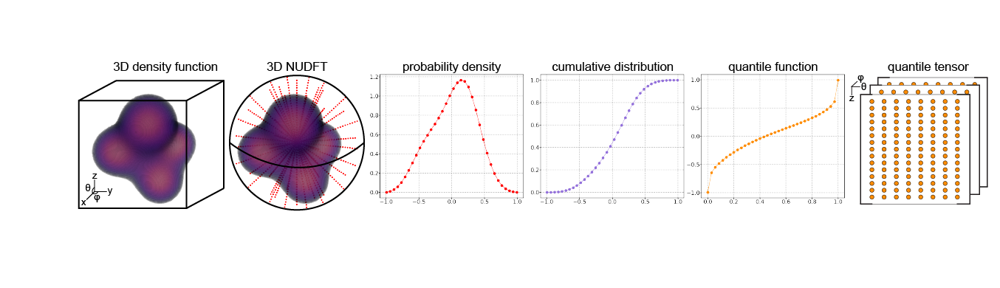

## Fast 3-D volume alignment in the sliced Wasserstein distance

We develop a fast algorithm for computing the sliced 2-Wasserstein distance over SO(3) between two 3-D volumes. 

---
Please contact my [first name last name 73][at]gmail.com with any questions.
